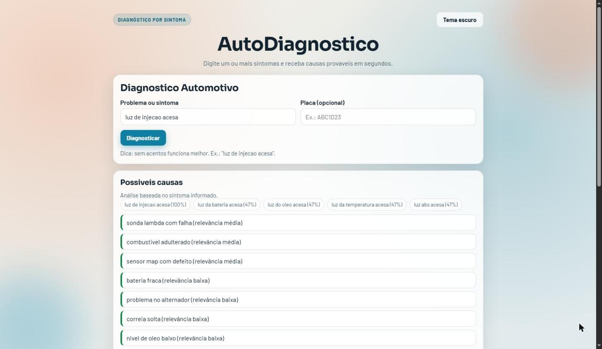

# AutoDiagnóstico

Detector de problemas automotivos por sintoma: o usuário descreve o que o carro está apresentando e recebe as causas mais prováveis em segundos.

**[Testar online](https://nycollef.github.io/Autodiagnostico/)**

## Funcionalidades

- Busca por um ou mais sintomas (ex.: "luz de injecao acesa")
- Lista de possíveis causas para cada sintoma
- Campo opcional de placa do veículo
- Histórico de diagnósticos, com pesquisa por sintoma
- Cadastro de novos sintomas e causas, salvo no navegador (localStorage)
- Tema claro e escuro

## O que pratiquei neste projeto

- Ler os sintomas e causas de um arquivo JSON com `fetch`
- Buscar sem ligar para acento ou maiúscula
- Ordenar as causas pela relevância
- Guardar o histórico no navegador com `localStorage`
- Tema claro e escuro

## Tecnologias

- HTML
- CSS
- JavaScript

## Como usar

1. Clone o repositório ou baixe os arquivos
2. Abra o arquivo `index.html` no navegador
3. Digite um sintoma e clique em **Diagnosticar**

## Por que criei este projeto

Trabalhando no atendimento de uma oficina, percebi que muitos clientes chegam descrevendo sintomas, e não o defeito. A ideia é agilizar essa primeira triagem e organizar as informações antes da avaliação do mecânico.

> **Aviso:** o resultado é apenas informativo e não substitui a avaliação de um profissional.
